# YummyPC

Неофициальный клиент YummyAnime для Windows: тёмный телевизионный интерфейс, встроенный плеер, списки, история, коллекции, новости и комментарии.

[](https://github.com/arbuzproject/YummyPC/releases/latest)
[](https://github.com/arbuzproject/YummyPC/releases)
[](LICENSE)

## Интерфейс

| | |
|---|---|
| 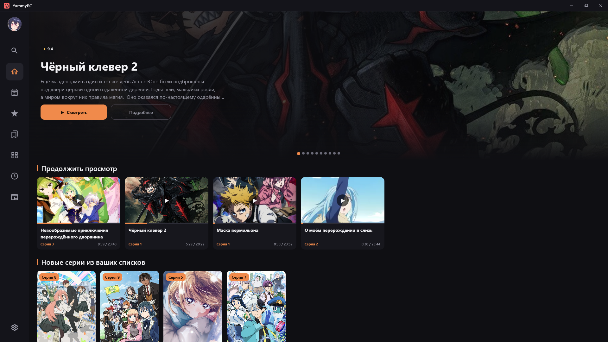 | 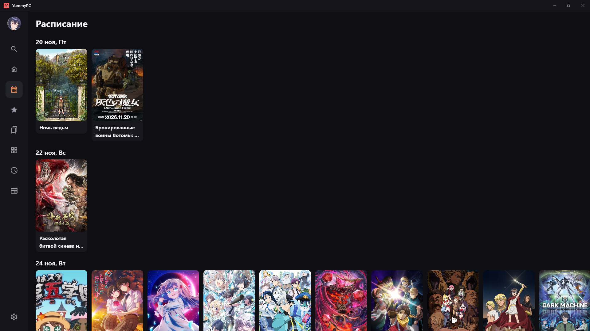 |
| 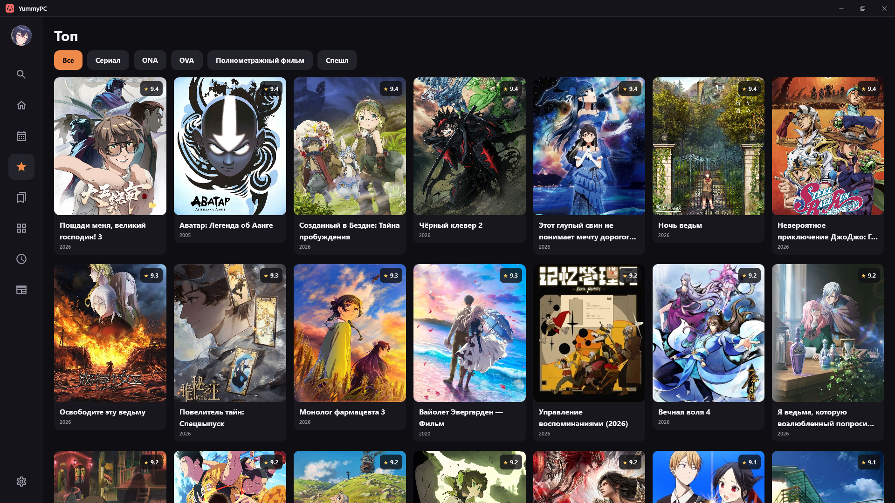 | 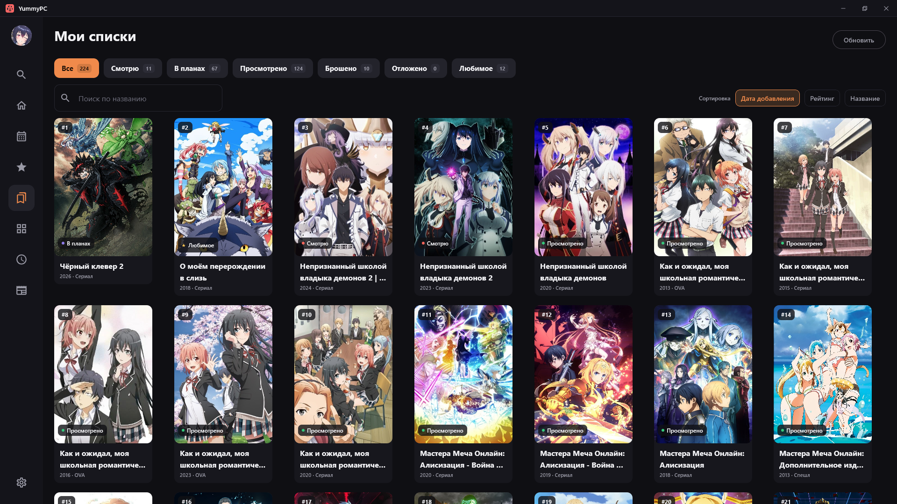 |
| 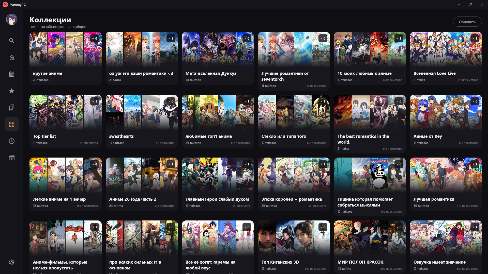 | 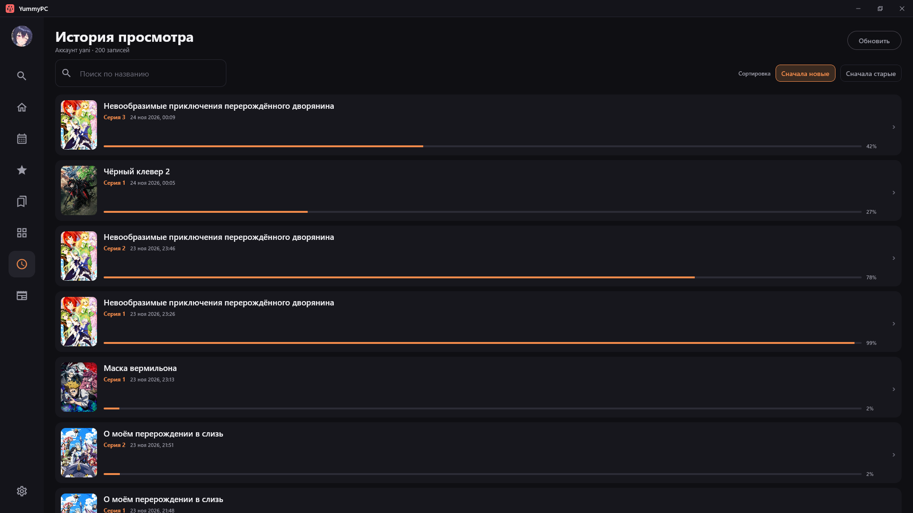 |
| 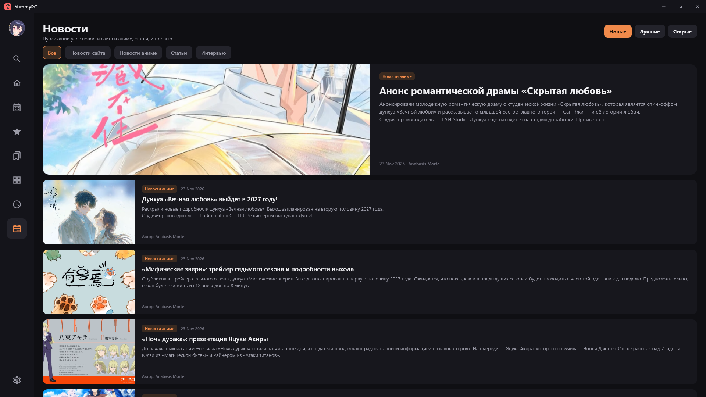 | 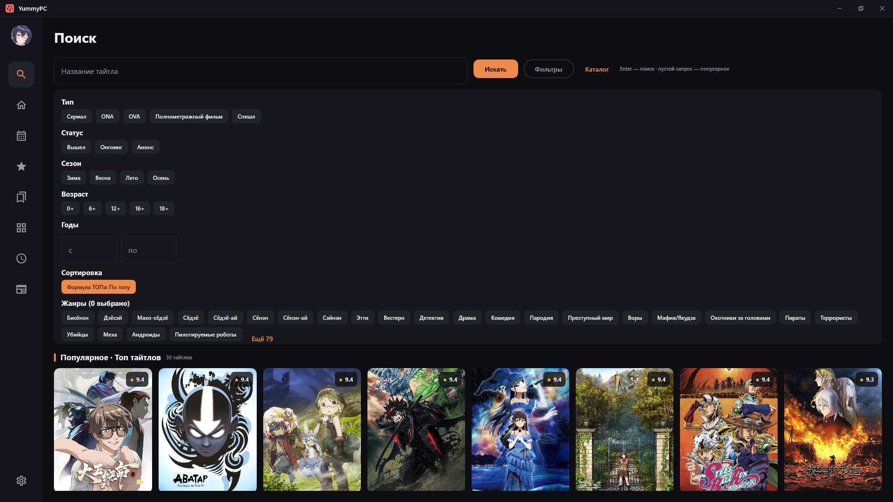 |
| 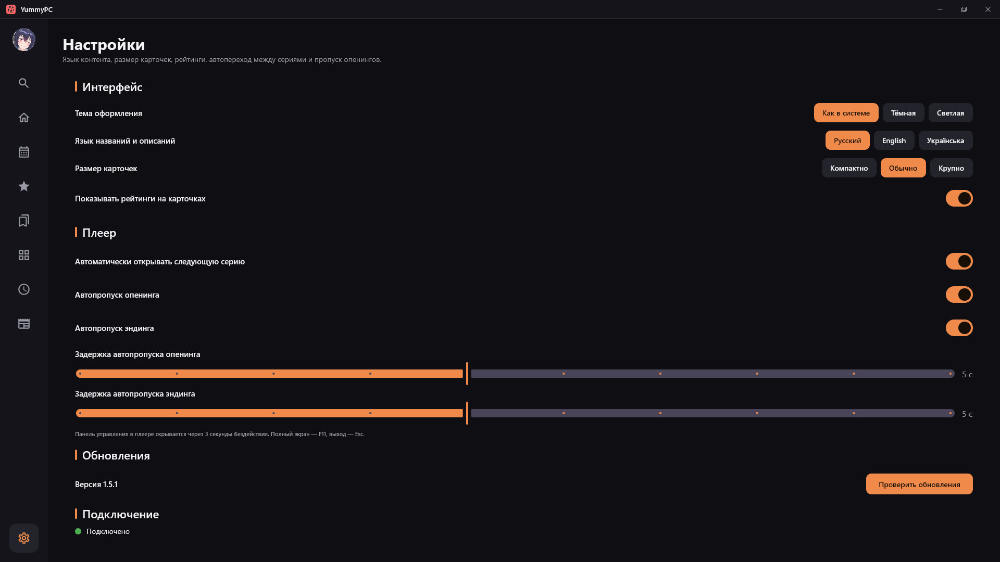 | 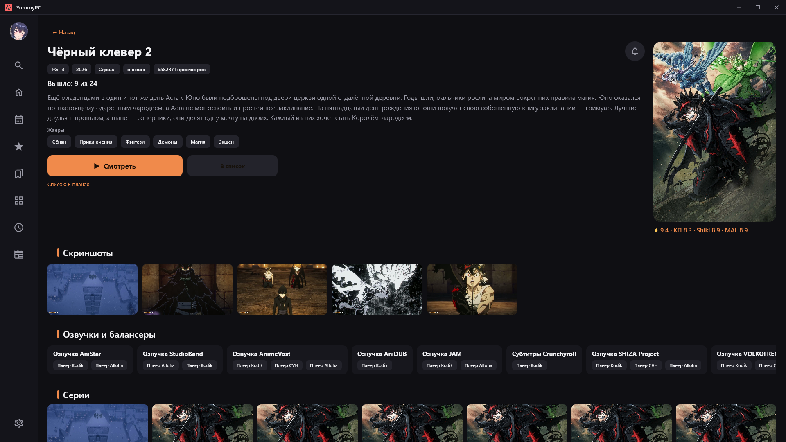 |

## Плеер

| | |
|---|---|
| 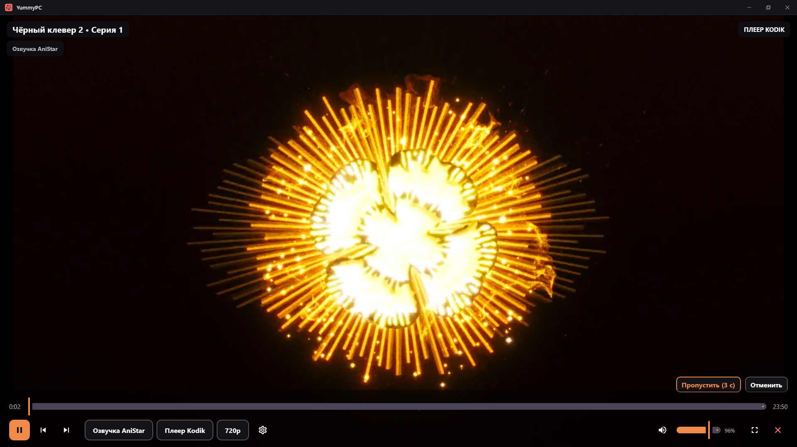 | 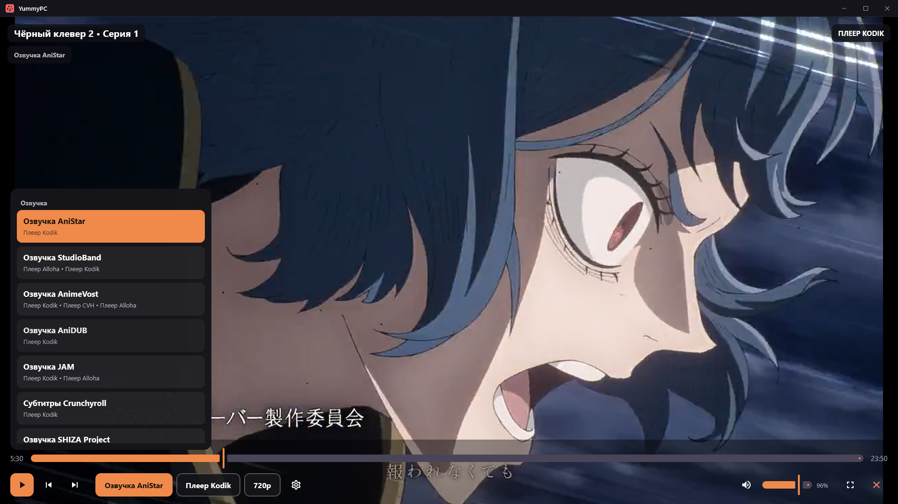 |
| 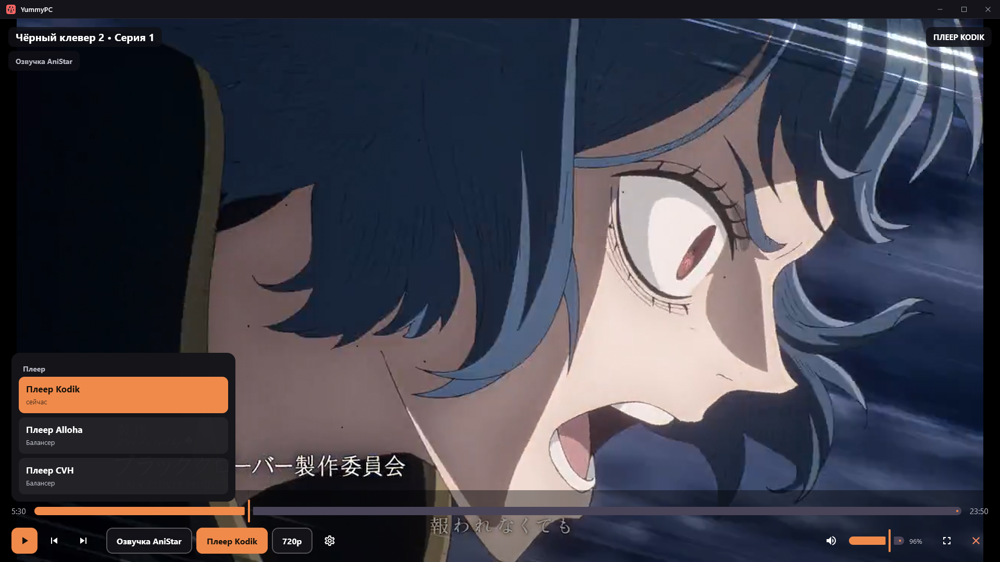 | 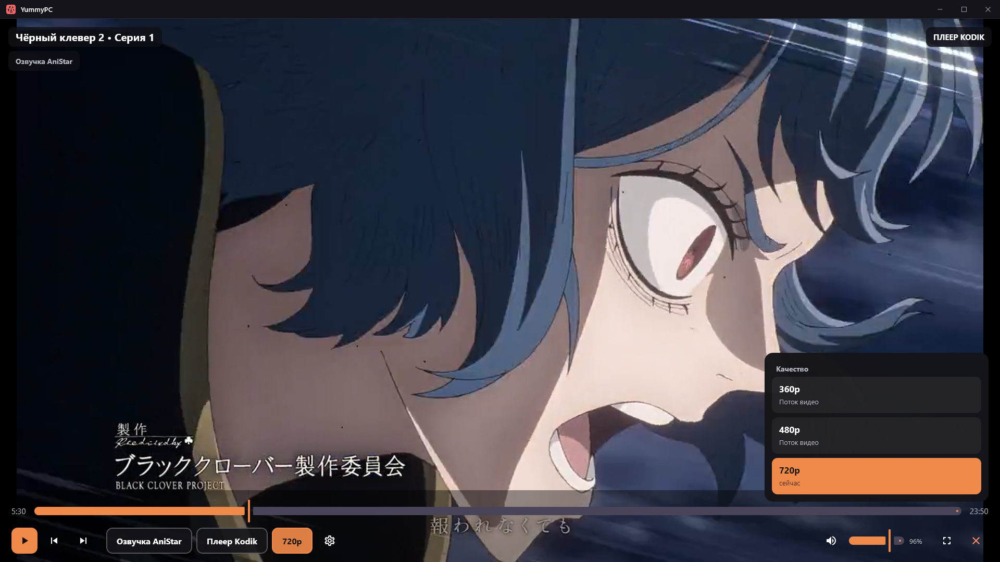 |

Настройки плеера: скорость, размер и цвет субтитров, фон, стабилизация громкости — открываются кнопкой ⚙ в плеере.

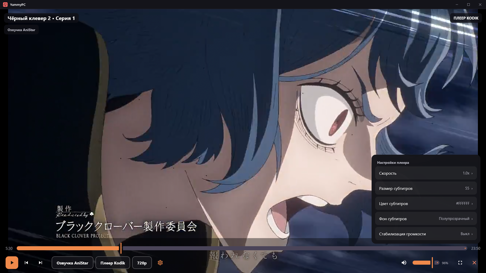

## Возможности

- Каталог, топ, поиск с фильтрами, расписание, новости и коллекции.
- Страница тайтла: скриншоты, описание, жанры, похожие, комментарии, выбор озвучки и балансера.
- Встроенный плеер на libmpv: видео и управление внутри окна приложения.
- Автопропуск опенинга и эндинга с независимыми задержками 1–10 секунд и отсчётом на кнопке.
- Продолжение просмотра, история, списки и локальная библиотека.
- Тёмная и светлая темы, масштаб карточек, проверка обновлений.
- Портативная версия и установщик.

## Установка

1. Скачайте `YummyPC-1.5.1-setup.exe` (установщик) или `YummyPC-1.5.1-portable.zip` (портативная версия).
2. Запустите `YummyPC.exe`.
3. Сервер уже настроен — дополнительная настройка не требуется.

Для работы плеера рядом с `YummyPC.exe` должен лежать `libmpv-2.dll` — он входит в обе сборки.

## Сборка

```bash
cd pc
gradlew.bat :app:createDistributable
```

Требования: JDK 21, Windows x64. Секреты сборки (адрес сервера) хранятся в `pc/secrets.properties` и в репозиторий не попадают.

## Структура

| Каталог | Назначение |
|---|---|
| `pc/app` | Compose Desktop приложение |
| `pc/api` | API YummyAnime, настройки, обновления |
| `pc/extractors` | Балансеры Kodik, Alloha, CVH |
| `pc/player-ipc` | Вспомогательный модуль плеера |
| `screenshots/` | Скриншоты приложения |

## Лицензия

CC BY-NC 4.0. Проект является неофициальным клиентом и не связан с администрацией YummyAnime.
