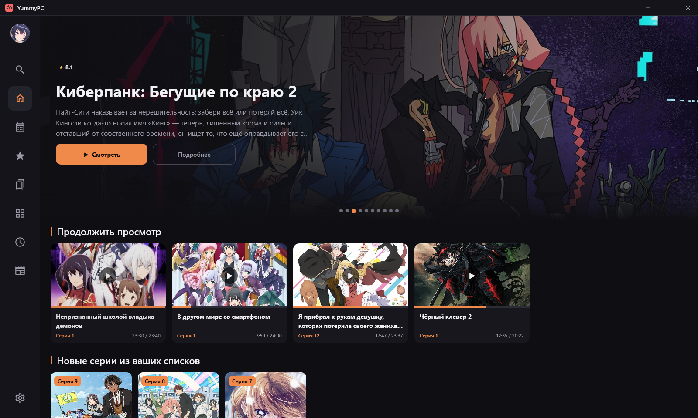
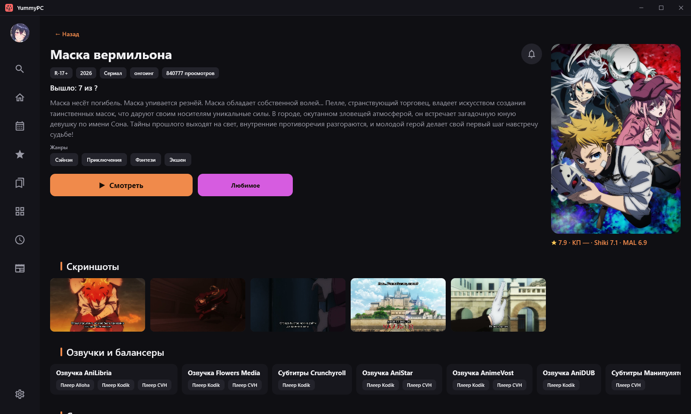
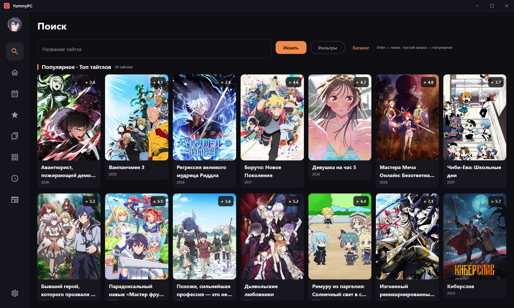
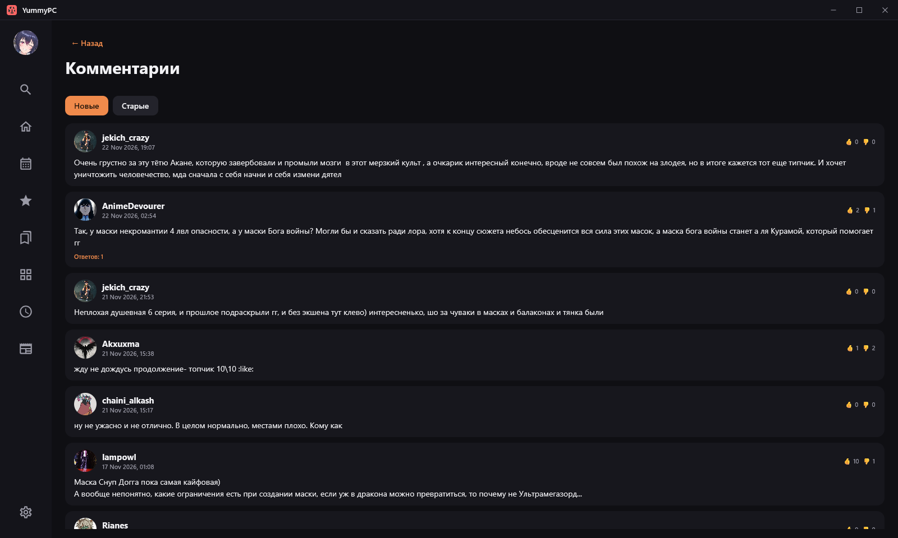
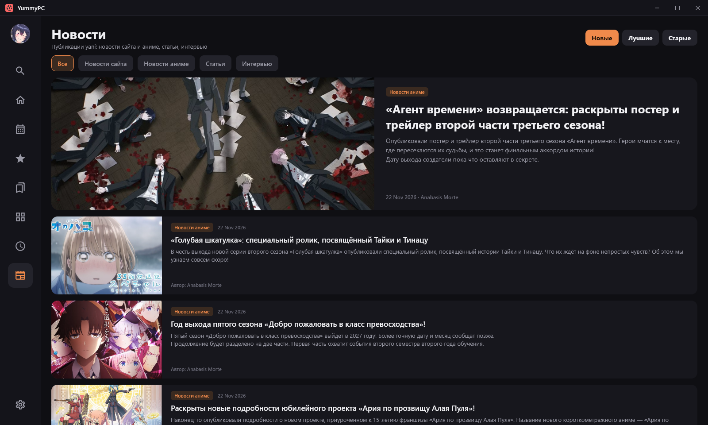
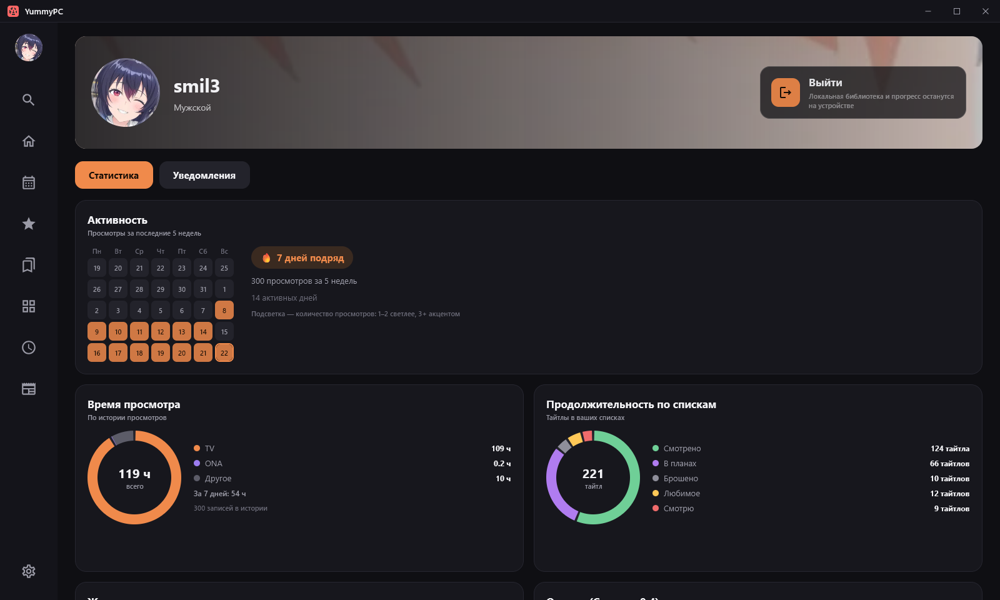
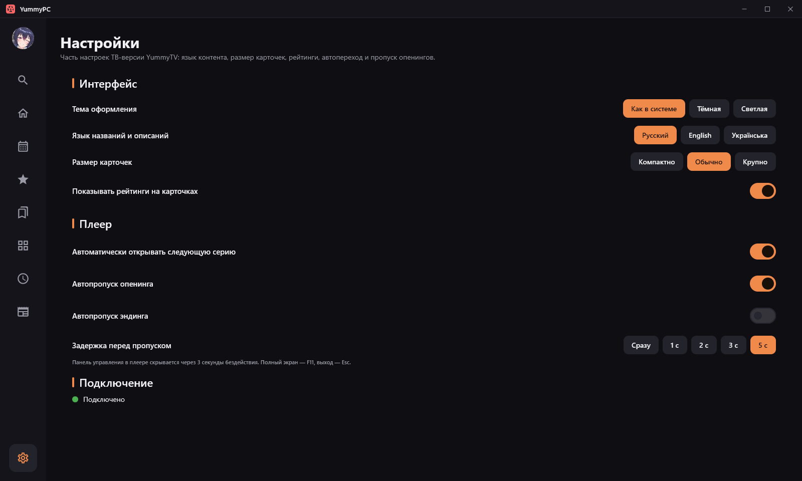

# YummyPC — неофициальный десктоп-клиент YummyAnime

Клиент YummyAnime для Windows на Kotlin + Compose Desktop со встроенным плеером на базе mpv.

[](https://github.com/arbuzproject/YummyPC/releases/latest)
[](https://github.com/arbuzproject/YummyPC/releases)
[](LICENSE)

> **Based on YummyTV — https://github.com/Helandy/YummyTV** (CC BY-NC 4.0).
> См. `LICENSE` и `NOTICE`. Проект не связан с YummyAnime и не является официальным клиентом.

## Скачать

Готовые сборки — в разделе **[Releases](https://github.com/arbuzproject/YummyPC/releases/latest)**:

- **Portable** (`YummyPC-1.0.7-portable.zip`) — распаковать и запустить `YummyPC.exe`, ничего устанавливать не нужно.
- **Установщик** (`YummyPC-1.0.7-setup.exe`) — обычная установка в систему.

Требования: Windows 10/11 x64. Плеер mpv входит в portable-сборку.

## Возможности

- Каталог, новинки, топ, расписание, поиск с фильтрами и сортировкой.
- Страница тайтла: рейтинги, скриншоты, озвучки и балансеры, серии, похожие тайтлы, жанры, подписка на новые серии, списки.
- Плеер в стиле ТВ-интерфейса: прозрачный оверлей с плашками тайтла/озвучки, большой кнопкой паузы, перемоткой, выбором озвучки/балансера/качества, настройками (скорость, субтитры), громкостью и горячими клавишами (пробел, ←/→, ↑/↓). Автопропуск опенинга/эндинга, автопереход, полный экран, синхронизация просмотров.
- Главная: продолжить просмотр, новые серии из ваших списков и новые серии всех тайтлов.
- Профиль: статистика просмотра, активность, списки, история, коллекции.
- Новости и комментарии.
- Автопроверка обновлений: при запуске появляется окно с изменениями нового релиза; в настройках есть «Проверить обновления».\n- Тёмная, светлая и системная темы оформления.
- Локальная библиотека: списки и история сохраняются на устройстве, если нет соединения или входа в аккаунт.

## Скриншоты

| | |
|---|---|
|  |  |
|  |  |
|  |
|  |  |
|  |  |

## Сборка

Требования: Windows 10/11 x64, **JDK 21**, **mpv**.

```powershell
$env:JAVA_HOME = 'C:\path\to\jdk-21'
cd pc
.\gradlew.bat :app:createDistributable
```

Готовая сборка появится в `pc\app\build\compose\binaries\main\app\YummyPC\`.
Рядом с `YummyPC.exe` положите `mpv\mpv.exe` и `mpv\mpv.com`.

Клиент не хранит токены сервиса: они остаются на серверной части (`backend/`).

**Готовые релизные сборки уже настроены** — скачайте и пользуйтесь, ничего указывать не нужно.
При сборке из исходников свой адрес сервера задаётся локально (`YUMMYPC_BACKEND`
или `%USERPROFILE%\.yummypc\settings.json` → `backendUrl`); в репозитории адресов нет.

## Структура

| Каталог | Что это |
|---|---|
| `pc/` | Gradle-проект клиента: `:api`, `:app`, `:extractors`, `:player-ipc` |
| `pc/docs/` | Документация: контракт API, экстракторы, плеер, правила порта |
| `backend/` | Серверная часть на Go: прокси к API и внешние балансеры |
| `screenshots/` | Скриншоты приложения |

## О проекте

Проект создан с помощью нейросетей: код, интерфейс и документация разрабатывались с использованием ИИ
(DeepSeek и другие модели). Возможны ошибки и неполные сценарии — используйте на свой риск.

## Лицензия

Производная работа от [YummyTV](https://github.com/Helandy/YummyTV), распространяется на условиях
**CC BY-NC 4.0**: свободное использование, изменение и распространение только в некоммерческих целях,
с указанием авторства. Полный текст — в `LICENSE`.
